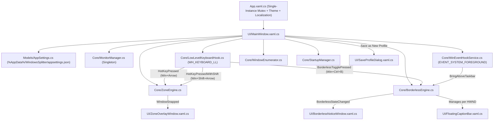

# Đặc tả Kỹ thuật (Technical Specification) - Windows Splitter

Tài liệu này mô tả chi tiết kiến trúc hệ thống, luồng xử lý Win32/WPF, mô hình dữ liệu, hành vi giao diện và các ràng buộc kỹ thuật của dự án **Windows Splitter** (`WindowsSplitter.csproj`).

---

## 1. Tổng quan công nghệ & Môi trường thực thi

| Thuộc tính | Giá trị | Nguồn định nghĩa |
| :--- | :--- | :--- |
| Nền tảng | `.NET 8.0` (`net8.0-windows`, `UseWPF = true`) | `WindowsSplitter.csproj` |
| Ngôn ngữ | C# (`Nullable = enable`, `ImplicitUsings = enable`) | `WindowsSplitter.csproj` |
| Kiểu xuất | `WinExe` (`WindowsSplitter.exe`) | `WindowsSplitter.csproj` |
| Thư viện UI | `WPF-UI` (`4.3.0`) | `WindowsSplitter.csproj` |
| System Tray | `Hardcodet.NotifyIcon.Wpf` (`2.0.1`) | `WindowsSplitter.csproj` |
| Quyền thực thi | `requireAdministrator` (`uiAccess="false"`) | `app.manifest` |
| DPI Awareness | `PerMonitorV2, PerMonitor` (`true/pm`) | `app.manifest` |
| Phiên bản đóng gói | `1.0.0` (Windows x64) | `installer/WindowsSplitter.iss` |

### Lý do bắt buộc quyền Administrator
* Hook bàn phím toàn cục (`WH_KEYBOARD_LL`) và các API thay đổi style/vị trí cửa sổ (`SetWindowLongPtr`, `SetWindowPos`, `DwmSetWindowAttribute`) bị cơ chế **UIPI (User Interface Privilege Isolation)** chặn nếu ứng dụng chạy ở mức quyền thường trong khi cửa sổ đích (game, terminal nâng quyền, công cụ hệ thống) chạy dưới quyền Administrator.

---

## 2. Kiến trúc tổng thể & Luồng khởi tạo

### Chu trình khởi động (`App.OnStartup` -> `MainWindow`)
1. Đăng ký message liên tiến trình `WM_SHOW_SPLITTER = RegisterWindowMessage("WindowsSplitter_ShowMainWindow_Msg")`.
2. Tạo `Mutex(true, "WindowsSplitter_SingleInstance_Mutex", out createdNew)`. Nếu `!createdNew`, phát `PostMessage(HWND_BROADCAST, WM_SHOW_SPLITTER, 0, 0)` để kích hoạt cửa sổ đang chạy rồi gọi `Shutdown()`.
3. Tải cấu hình `AppSettings.Load()`, gọi `LocalizationManager.Initialize(settings.Language)` và áp dụng `ApplicationThemeManager.Apply(ApplicationTheme.Dark)`.
4. `MainWindow` khởi tạo các engine/hook: `ZoneEngine`, `BorderlessEngine`, `WinEventHookService`, `LowLevelKeyboardHook`.
5. Khởi chạy `_keyboardHook.Start()` và `_winEventHookService.Start()`, nạp danh sách màn hình, thiết lập UI và danh sách cửa sổ đang mở.
6. Kiểm tra tham số dòng lệnh `--minimized` hoặc `AppSettings.StartMinimizedToTray`; nếu đúng thì đặt `WindowState = Minimized` và gọi `Hide()`.
7. Trong `OnSourceInitialized`, đăng ký `HwndSource.AddHook(WndProc)` để xử lý:
   * `App.WM_SHOW_SPLITTER`: Hiện lại `MainWindow` từ khay hệ thống và focus.
   * `NativeMethods.WM_DISPLAYCHANGE`: Làm mới `MonitorManager.Instance.RefreshMonitors()`, cập nhật ComboBox màn hình và sơ đồ trực quan.

---

## 3. Đặc tả các Module Cốt lõi (`Core/`)

### 3.1. `NativeMethods.cs`
Tập trung toàn bộ khai báo P/Invoke và hằng số Win32:
* **`user32.dll`:** `GetForegroundWindow`, `SetForegroundWindow`, `GetWindowRect`, `GetClientRect`, `SetWindowPos`, `RedrawWindow`, `ShowWindow`, `RegisterWindowMessage`, `PostMessage`, `SendMessage`, `IsWindowVisible`, `IsIconic`, `IsZoomed`, `GetShellWindow`, `GetDesktopWindow`, `GetWindowText`, `GetWindowTextLength`, `GetClassName`, `EnumWindows`, `GetWindowThreadProcessId`, `MonitorFromWindow`, `MonitorFromPoint`, `GetMonitorInfo`, `EnumDisplayMonitors`, `GetSystemMetrics`, `GetDpiForWindow`, `GetCursorPos`, `GetWindowPlacement`, `SetWindowPlacement`, `SetWindowsHookEx`, `UnhookWindowsHookEx`, `CallNextHookEx`, `SetWinEventHook`, `UnhookWinEvent`, `GetAsyncKeyState`, `GetWindowLongPtr` / `SetWindowLongPtr` (tự chọn bản 32-bit/64-bit theo `IntPtr.Size`).
* **`dwmapi.dll`:** `DwmGetWindowAttribute` (`DWMWA_EXTENDED_FRAME_BOUNDS = 9`), `DwmSetWindowAttribute` (`DWMWA_WINDOW_CORNER_PREFERENCE = 33`, enum `DWM_WINDOW_CORNER_PREFERENCE`).
* **`shcore.dll`:** `GetDpiForMonitor`.
* **`kernel32.dll`:** `GetModuleHandle`, `OpenProcess` (`PROCESS_QUERY_LIMITED_INFORMATION = 0x1000`), `CloseHandle`, `QueryFullProcessImageName`.

### 3.2. `MonitorManager.cs`
* Singleton `MonitorManager.Instance`, lưu `List<MonitorInfoItem> Monitors` và cờ `IsDuplicateMode`.
* `RefreshMonitors()`:
  1. Gọi `EnumDisplayMonitors` + `GetMonitorInfo` (`MONITORINFOEX`) lấy `Bounds` (`rcMonitor`), `WorkArea` (`rcWork`), `DeviceName` (`szDevice`), và `IsPrimary` (`MONITORINFOF_PRIMARY`).
  2. Truy vấn DPI từng màn hình bằng `GetDpiForMonitor(hMon, 0, out px, out py)` và quy đổi `DpiScaleX = px / 96.0`, `DpiScaleY = py / 96.0`.
  3. Sắp xếp màn hình theo thứ tự vật lý từ trái sang phải, trên xuống dưới: `OrderBy(m => m.Bounds.Left).ThenBy(m => m.Bounds.Top)`.
  4. Xác định `IsDuplicateMode`: nếu `list.Count > 1` và tất cả màn hình có `Bounds` (`Left`, `Top`, `Width`, `Height`) giống hệt nhau.
* Phân loại màn hình trên `MonitorInfoItem`:
  * `IsUltrawide`: `Height > 0 && ((double)Width / Height) >= 2.0`.
  * `IsVertical`: `Height > Width`.
* `GetNextMonitor(current, direction)`: di chuyển sang trái/phải theo danh sách đã sắp xếp, tự cuộn vòng hai đầu (`0 <-> Count - 1`).

### 3.3. `LowLevelKeyboardHook.cs`
* Cài đặt hook `WH_KEYBOARD_LL` (ID `13`).
* Sử dụng `GetAsyncKeyState` kết hợp biến trạng thái `_isWinDown` để đọc trạng thái phím vật lý (`VK_LWIN`, `VK_RWIN`, `VK_CONTROL`, `VK_SHIFT`).
* **Các tổ hợp phím xử lý (và chặn chuyển tiếp bằng cách trả về `(IntPtr)1`):**
  1. `Win + Ctrl + B` (không kèm `Shift`): Bật/tắt Borderless (`BorderlessTogglePressed`). Có cờ `_isBorderlessToggleDown` chống kích hoạt lặp khi giữ phím (`WM_KEYUP` / `WM_SYSKEYUP` mới reset).
  2. `Win + Shift + Arrow` (không kèm `Ctrl`, khi `EnableWinShiftMonitorMove == true`): Phát `HotKeyPressedWithShift(direction)`.
  3. `Win + Arrow` (không kèm `Ctrl` và `Shift`, khi `OverrideWindowsSnap == true`): Phát `HotKeyPressed(direction)`.

### 3.4. `ZoneEngine.cs` & `TopEdgeSnapGuard.cs`
Quản lý trạng thái Zone cho từng cửa sổ qua `_windowCurrentZoneMap` (`Dictionary<IntPtr, int>`) và `_windowOriginalBoundsMap` (`Dictionary<IntPtr, RECT>`).

* **Quy đổi vùng theo `WorkArea` (`ResolveZonesForMonitor`):**
  * Khi `preset.SplitRoot != null`, tính tọa độ trực tiếp trên `(monitor.WorkArea.Width, monitor.WorkArea.Height, preset.ZoneGap)` để các vùng xếp tầng theo chiều dọc không bao giờ bị che bởi Taskbar.
* **Xác định Zone hiện tại (`GetWindowCurrentZone`):**
  * Ưu tiên tra `_windowCurrentZoneMap`; nếu chưa có thì đo **diện tích giao 2D** (`overlapX * overlapY`) giữa `DWMWA_EXTENDED_FRAME_BOUNDS` (fallback `GetWindowRect`, quy về `WorkArea`) và từng `Zone`, chọn vùng có diện tích giao lớn nhất (`> 10000 px^2`).
* **Điều hướng không gian 2D (`FindNeighborZone` & `SnapWindow`):**
  1. Bỏ qua cửa sổ không hiển thị, `DesktopWindow`, `ShellWindow`, và các class hệ thống (`Shell_TrayWnd`, `Progman`, `WorkerW`).
  2. Nếu đang Maximize (`IsZoomed`): `Up`/`Down` gọi `SW_RESTORE` (và với `Down` sẽ snap lại về Zone trước đó nếu có trong `_windowCurrentZoneMap`); `Left`/`Right` gọi `SW_RESTORE` rồi snap vào Zone.
  3. Nếu cửa sổ chưa thuộc Zone nào: `Up` Maximize, `Down` Minimize, `Left` vào Zone sát mép trái nhất, `Right` vào Zone sát mép phải nhất.
  4. Nếu đã ở trong Zone: `FindNeighborZone` tìm Zone liền kề theo hướng mũi tên có phần chồng lấn theo trục vuông góc (`OrthoOverlap > 4`), ưu tiên `EdgeGap` nhỏ nhất và `OrthoDist` gần tâm nhất.
     * Khi chạm mép trên (`Up` không còn lân cận): giữ Zone hiện tại trong `_windowCurrentZoneMap` và `SW_MAXIMIZE`.
     * Khi chạm mép dưới (`Down` không còn lân cận): `SW_MINIMIZE`.
     * Khi chạm mép Trái/Phải và bật `EnableCrossMonitorWrap` (khi có > 1 màn hình): nhảy sang Zone mép tương ứng ở màn hình kế tiếp (ưu tiên cùng cao độ dọc `CenterY`).
* **Quy trình `ApplyWindowToZone(hWnd, targetZone, monitor)`:**
  1. Tính khung hình mục tiêu trên `monitor.WorkArea` (`monLeft + targetZone.X`, `monTop + targetZone.Y`).
  2. **Bù trừ viền tàng hình DWM 2 lượt:** Chỉ áp dụng khi `DwmInvisibleBorderCompensation == true && hasDwmFrame`:
     * Lượt 1: Đo `DWMWA_EXTENDED_FRAME_BOUNDS` trừ `GetWindowRect` (fallback `BorderCompensationPixels = 7` cho trái/phải/dưới), đặt `DWMWCP_DONOTROUND` (nếu bật) và gọi `SetWindowPos`.
     * Lượt 2: Đo lại `DWMWA_EXTENDED_FRAME_BOUNDS` sau khi di chuyển và hiệu chỉnh `deltaLeft`, `deltaTop`, `deltaRight`, `deltaBottom` (nếu `|delta| <= 24`) để triệt tiêu khe hở ở mọi cạnh (kể cả mép trên).
  3. Phát sự kiện `WindowSnapped(hWnd, targetZone, visualRect)` để kích hoạt `ZoneOverlayWindow`.
* **`TopEdgeSnapGuard.cs`:**
  * Hook `WH_MOUSE_LL` (chỉ kiểm tra `WM_LBUTTONDOWN` và `WM_LBUTTONUP` tương ứng khi `PreventAccidentalTopEdgeMaximize == true`).
  * Nếu con trỏ nằm trong dải mép trên màn hình (`[WorkArea.Top, WorkArea.Top + 8]`) trên một cửa sổ đang snap ở Zone sát mép trên (`Y <= 4`, `!IsZoomed`) và `SendMessageTimeout(WM_NCHITTEST)` trả về `HTTOP (12)`, chặn sự kiện `HTTOP` resize để Windows Snap không tự phóng to cửa sổ và gọi `SetForegroundWindow` để focus bình thường.

### 3.5. `BorderlessEngine.cs` & `WinEventHookService.cs`
* **`WindowStateBackup`:** Lưu `OriginalStyle`, `OriginalExStyle` (đã loại bỏ `WS_EX_TOPMOST`), `OriginalRect`, `IsBorderless`, `CoveredTaskbar`, và tham chiếu `FloatingCaptionBar?`.
* **`ApplyBorderless(hWnd, targetZone = null)`:**
  1. Nếu cửa sổ đang Maximize -> `SW_RESTORE`.
  2. Nếu chưa được theo dõi trong `_managedWindows`: sao lưu style và rect gốc. Trường hợp cửa sổ bị bắt khi đã mất `WS_CAPTION` hoặc đang full-screen, tái tạo fallback `WS_OVERLAPPEDWINDOW | WS_VISIBLE` và khung khôi phục 75% `WorkArea` ở giữa màn hình.
  3. Xóa các cờ style: `WS_CAPTION`, `WS_THICKFRAME`, `WS_MINIMIZEBOX`, `WS_MAXIMIZEBOX`, `WS_SYSMENU`, `WS_BORDER`, `WS_DLGFRAME`; bật `WS_POPUP | WS_VISIBLE`.
  4. Áp dụng `DWMWCP_DONOTROUND` nếu cấu hình `DisableWin11RoundedCorners == true`.
  5. Xác định vị trí đích:
     * Nếu có `targetZone` (hoặc `_zoneEngine.GetWindowCurrentZone(hWnd)` khác null): đặt theo tọa độ Zone trên `targetMonitor.Bounds`.
     * Nếu chưa snap vào Zone: phủ toàn màn hình `targetMonitor.Bounds` (bao gồm cả vùng Taskbar).
  6. `SetBorderlessBounds`: Gọi `SetWindowPos` với `HWND_TOPMOST`, sau đó đo lại độ lệch `DWMWA_EXTENDED_FRAME_BOUNDS` vs `GetWindowRect` và gọi lại `SetWindowPos` để triệt tiêu phần inset thừa nếu ứng dụng giữ lại viền DWM bất đối xứng.
  7. Tạo hoặc cập nhật vị trí `FloatingCaptionBar` ở góc trên phải vùng đích (`targetX + targetW, targetY`) theo DPI của màn hình đó.
  8. Phát `BorderlessStateChanged(hWnd, true)` (hiển thị `BorderlessNoticeWindow`).
* **`RestoreWindow(hWnd)` & `CleanUp()`:**
  * Khôi phục `GWL_STYLE` (đảm bảo có `WS_CAPTION`, bỏ `WS_POPUP`) và `GWL_EXSTYLE` (bỏ `WS_EX_TOPMOST`).
  * Đặt lại `DWMWA_WINDOW_CORNER_PREFERENCE = DWMWCP_DEFAULT`.
  * Gọi `SetWindowPos` với `HWND_NOTOPMOST` về `OriginalRect`, sau đó gọi `RedrawWindow(..., RDW_FRAME | RDW_INVALIDATE | RDW_UPDATENOW | RDW_ALLCHILDREN)`.
  * Đóng `FloatingCaptionBar` và phát `BorderlessStateChanged(hWnd, false)`.
  * `CleanUp()` được gọi trong `MainWindow.OnClosing` để trả toàn bộ cửa sổ đang Borderless về trạng thái bình thường trước khi thoát.
* **`WinEventHookService.cs`:**
  * Đăng ký `SetWinEventHook` cho `EVENT_SYSTEM_FOREGROUND` (`0x0003`). Khi một cửa sổ Borderless có `CoveredTaskbar == true` được đưa lên foreground, gọi `BringAboveTaskbar` (`SetWindowPos(..., HWND_TOPMOST, SWP_NOMOVE | SWP_NOSIZE | SWP_NOACTIVATE)`).

### 3.6. `WindowEnumerator.cs`
* Liệt kê các cửa sổ đang chạy qua `EnumWindows`:
  * Bỏ qua `ShellWindow`, `DesktopWindow`, cửa sổ ẩn, cửa sổ có tiêu đề rỗng, `Shell_TrayWnd`, `Windows.UI.Core.CoreWindow`, Tooltip.
  * Bỏ qua `WS_EX_TOOLWINDOW` trừ khi cửa sổ đó đang ở chế độ Borderless do app quản lý.
  * Cho phép hiển thị `MainWindow` của chính `WindowsSplitter.exe` trong danh sách để người dùng có thể khôi phục nếu áp dụng Borderless nhầm lên cửa sổ chính, nhưng lọc bỏ các cửa sổ phụ nội bộ.
* Trích xuất icon theo 3 bước fallback: `WM_GETICON` (`ICON_SMALL2` -> `ICON_SMALL` -> `ICON_BIG`) -> `GetClassLongPtr` (`GCL_HICONSM` -> `GCL_HICON`) -> `ExtractIconEx` từ file `.exe`.

### 3.7. `LocalizationManager.cs` & `StartupManager.cs`
* **`LocalizationManager`:** Hỗ trợ `"en"` (mặc định) và `"vi"`. Thay thế `ResourceDictionary` ngôn ngữ trong `Application.Current.Resources.MergedDictionaries` tại runtime và phát sự kiện `LanguageChanged`.
* **`StartupManager`:**
  * Bật khởi động cùng Windows: chạy `schtasks.exe /Create /TN "WindowsSplitter_Elevated" /TR "\"<exePath>\" [--minimized]" /SC ONLOGON /RL HIGHEST /IT /F`. Nếu thất bại, fallback ghi `HKCU\Software\Microsoft\Windows\CurrentVersion\Run`.
  * Tắt: xóa cả task trên Task Scheduler và giá trị Registry Run.

---

## 4. Mô hình Dữ liệu & Lưu trữ (`Models/`)

### 4.1. `AppSettings.cs` (`%AppData%\WindowsSplitter\appsettings.json`)

| Thuộc tính | Kiểu | Mặc định | Ý nghĩa |
| :--- | :--- | :--- | :--- |
| `OverrideWindowsSnap` | `bool` | `true` | Ghi đè phím tắt `Win + Arrow` |
| `DisableWin11RoundedCorners` | `bool` | `true` | Tắt bo góc Win 11 khi vào Zone / Borderless |
| `DwmInvisibleBorderCompensation` | `bool` | `true` | Bù trừ viền tàng hình DWM |
| `BorderCompensationPixels` | `int` | `7` | Giá trị bù trừ fallback (pixel) |
| `ShowZoneOverlayOnSnap` | `bool` | `true` | Hiện `ZoneOverlayWindow` khi snap |
| `ZoneOverlayDurationMs` | `int` | `500` | Thời gian giữ overlay trước khi mờ dần (ms) |
| `StartMinimizedToTray` | `bool` | `false` | Khởi động thu gọn xuống khay hệ thống |
| `CloseToTray` | `bool` | `false` | Bấm nút đóng (`X`) sẽ ẩn xuống tray thay vì thoát |
| `StartWithWindows` | `bool` | `false` | Đăng ký chạy cùng Windows |
| `Language` | `string` | `"en"` | Ngôn ngữ giao diện (`"en"` hoặc `"vi"`) |
| `EnableCrossMonitorWrap` | `bool` | `true` | Cho phép `Win + Arrow` cuộn vòng qua màn hình kế tiếp |
| `EnableWinShiftMonitorMove` | `bool` | `true` | Cho phép `Win + Shift + Arrow` đổi màn hình |
| `PreventAccidentalTopEdgeMaximize` | `bool` | `true` | Chặn bung toàn màn hình khi bấm nhầm `HTTOP` ở mép trên Zone |
| `SelectedPresetId` | `string` | `""` | ID Preset fallback cấp ứng dụng |
| `Presets` | `List<ZonePreset>` | Auto | Danh sách Preset fallback |
| `MonitorConfigs` | `List<MonitorLayoutConfig>` | `[]` | Cấu hình Preset độc lập theo `DeviceName` màn hình |

### 4.2. `ZoneLayout.cs`
* **`Zone`:** `Id`, `Name`, `X`, `Y`, `Width`, `Height` (pixel theo `WorkArea`) và `PercentX`, `PercentY`, `PercentWidth`, `PercentHeight` (`0..100%`).
* **`ZoneSplitNode` (Cây chia cắt đệ quy - Recursive Binary Split Tree):**
  * `Orientation` (`None`, `Vertical`, `Horizontal`), `SplitRatio` (`0.05..0.95`), `ZoneId`, `First`, `Second`.
  * Bảo đảm phân hoạch toàn bộ vùng không gian thành các hình chữ nhật **không bao giờ chồng chéo**.
  * Hỗ trợ `ComputeZones` (đánh số `Zone 1..N` từ trên xuống dưới, trái sang phải, tính cả `ZoneGap`), `GetDividers` (sinh danh sách đường biên kéo thả kèm giới hạn kích thước tối thiểu 80px/vùng), `SplitLeaf`, `RemoveLeaf`, `TryApplyZoneBounds`, và `ReconstructFromZones` (tái dựng cây từ preset legacy nếu `SplitRoot == null`).
* **`ZonePreset`:** `Id`, `Name`, `Description`, `ScreenWidth`, `ScreenHeight`, `ZoneGap`, `IsDefault`, `SplitRoot`, `Zones`. Các Preset có `IsDefault = true` không thể bị xóa (`CanDelete = false`) hay ghi đè (`CanOverwrite = false`).
* **Quy tắc sinh Preset mặc định (`ZonePreset.CreateDefaultPresets(screenWidth, screenHeight)`):**
  1. **Màn hình dọc (`screenHeight > screenWidth`):** `preset_vert_half`, `preset_vert_triple`, `preset_grid_2x2`.
  2. **Ultrawide (`screenWidth / screenHeight >= 2.0`):** `preset_ultrawide_2k`, `preset_half_half`, `preset_triple`, `preset_center_focus`, `preset_priority_grid` (4 vùng), `preset_grid_2x2` (4 vùng), `preset_asymmetric_5` (5 vùng lệch tâm).
  3. **Màn hình tiêu chuẩn (`16:9` / `16:10`):** `preset_standard_1_3`, `preset_standard_half`, `preset_standard_2_3`, `preset_standard_triple`, `preset_priority_grid` (3 vùng), `preset_grid_2x2` (4 vùng), `preset_asymmetric_5` (5 vùng lệch tâm).
* **`MonitorLayoutConfig`:** Gắn `DeviceName`, `ScreenWidth`, `ScreenHeight`, `SelectedPresetId`, và `Presets` riêng cho từng màn hình.

---

## 5. Đặc tả Giao diện & Cửa sổ Phụ (`UI/`)

### 5.1. `MainWindow.xaml` / `MainWindow.xaml.cs`
* **Kích thước:** `1120 x 780` (tối thiểu `980 x 680`), Dark Theme (`#181818` nền chính, `#222222` card, `#0078D4` accent).
* **Header:** Tên ứng dụng, bộ chọn ngôn ngữ nhanh, badge `Duplicate Mode Active` (ẩn mặc định, hiện khi `IsDuplicateMode`), badge trạng thái quyền Admin, badge trạng thái `Win+Arrow`, nút thu nhỏ xuống System Tray.
* **3 Tab chính:**
  1. **Zone Manager:** Chọn màn hình (`CmbMonitors`), hiển thị DPI%, chọn Preset/Profile (`CmbPresets`), tạo/xóa Custom Profile, thanh công cụ tách/gộp vùng (`Split Vertical`, `Split Horizontal`, `Merge / Remove Zone`), thanh trượt `Zone Gap (px)`, sơ đồ tương tác 2D (`CanvasZoneEditor`) giữ đúng tỷ lệ màn hình cho phép chọn từng Zone và kéo trực tiếp các đường phân chia, cùng bảng thông số Zone đang chọn với bộ chuyển đơn vị **Pixel (`px`) / Phần trăm (`%`)** và nút `Apply Dimensions`. Khi chỉnh sửa trên Preset mặc định, hệ thống giữ bản xem trước `_workingPreset` độc lập và nhắc lưu thành Profile mới (`IsDefault` không bị biến đổi).
  2. **Smart Borderless:** Ô tìm kiếm theo tên tiến trình hoặc tiêu đề cửa sổ, danh sách `ListRunningApps` với icon, badge trạng thái Borderless và nút thao tác nhanh (`Borderless` / `Restore`).
  3. **Settings:** Ngôn ngữ hiển thị, Khởi động cùng Windows / Khay hệ thống, 7 tùy chọn hành vi & đa màn hình (bao gồm `PreventAccidentalTopEdgeMaximize`), bảng tra cứu phím tắt nhanh.
* **System Tray (`Hardcodet.Wpf.TaskbarNotification.TaskbarIcon`):** Double-click để mở lại cửa sổ, menu chuột phải gồm `Open Settings` và `Exit Application` (trong code-behind còn giữ sẵn các handler `MenuToggleHook_Click`, `MenuSnapZone1_Click`, `MenuSnapZone2_Click`, `MenuMoveOtherMonitor_Click` cho khả năng mở rộng lại menu tray nếu cần).

### 5.2. Các cửa sổ Overlay & Dialog
* **`FloatingCaptionBar`:** Kích thước cơ sở `114 x 36`, định vị bằng `SetWindowPos` theo pixel vật lý nhân `dpiScaleX`/`dpiScaleY`, cờ `WS_EX_NOACTIVATE | WS_EX_TOOLWINDOW | WS_EX_TOPMOST`. Timer `50ms` kiểm tra `GetCursorPos` trong vùng thanh nút (+10px phía dưới) hoặc phím `Alt` (`VK_MENU`), chạy animation trượt `Y: -24 -> 0` và `Opacity: 0.15 -> 1.0` trong `180ms`.
* **`ZoneOverlayWindow`:** Cửa sổ click-through (`WS_EX_TRANSPARENT | WS_EX_NOACTIVATE | WS_EX_TOOLWINDOW | WS_EX_TOPMOST`), định vị chính xác theo `RECT` pixel vật lý, fade-in `120ms`, giữ `ZoneOverlayDurationMs` (`500ms`), fade-out `200ms`.
* **`BorderlessNoticeWindow`:** Kích thước cơ sở `420 x 100` (nhân DPI của màn hình chứa cửa sổ mục tiêu), hiển thị thông báo `BORDERLESS MODE` và tự đóng sau `2800ms`.
* **`SaveProfileDialog`:** Nhập tên + mô tả Profile, sinh ID dạng `custom_<8-char-guid>` với `IsDefault = false`.

### 5.3. Quy ước thiết kế UI (Design Constraints)
* Tham chiếu quy chuẩn Dark UI tại `WPF_UI_DESIGN_SYSTEM.md`.
* **Quy ước icon & nội dung:** Không sử dụng các biểu tượng trang trí kiểu AI agent (như tên lửa, pháo hoa, đĩa bay, ngôi sao lấp lánh) trong thiết kế giao diện và tài liệu. Lưu ý hiện trạng: một số chuỗi trong `Resources/Languages/Strings.en.xaml`, `Strings.vi.xaml`, `MonitorManager.cs` và `ZoneLayout.cs` vẫn còn ký tự emoji inline từ giai đoạn đầu; khi chuẩn hóa UI về sau nên thay thế bằng văn bản thuần hoặc glyph vector / `Segoe Fluent Icons`.

---

## 6. Đóng gói & Phân phối (`installer/`)

* `installer/build-installer.bat`:
  1. Chạy `dotnet publish "WindowsSplitter.csproj" -c Release -r win-x64 --self-contained true -o "publish\win-x64"`.
  2. Tìm `ISCC.exe` (PATH hoặc thư mục cài đặt Inno Setup 6) và biên dịch `installer/WindowsSplitter.iss`.
* `installer/WindowsSplitter.iss`:
  * Cài đặt x64 vào `{autopf}\Windows Splitter`, yêu cầu `PrivilegesRequired=admin`.
  * Trang thỏa thuận EULA (`License.txt`) và trang xác nhận bắt buộc (`AdminConsentPage`) yêu cầu người dùng tick đồng ý chạy với quyền Administrator.
  * Tùy chọn chạy sau cài đặt dùng `Verb: "runas"`.

---

## 7. Tổ chức ngữ cảnh cho AI Agent đa máy (Antigravity & CodeGraph)

Để khi mở project trên bất kỳ máy nào bằng **Antigravity**, AI Agent nắm được kiến trúc ngay mà không cần quét lại toàn bộ mã nguồn:

1. **Tài liệu tĩnh tự động nạp (`AGENTS.md` + `TECHNICAL_SPEC.md`):**
   * Antigravity tự động phát hiện file `AGENTS.md` ở thư mục gốc repository trên mọi máy mà không cần cài đặt thêm công cụ ngoài. `AGENTS.md` cung cấp bản đồ file, lệnh build và các bất biến Win32/UI.
2. **Đánh giá công cụ `colbymchenry/codegraph` (`@colbymchenry/codegraph`):**
   * **Cơ chế hoạt động:** Dùng Tree-sitter phân tích AST (hỗ trợ C# và nhiều ngôn ngữ khác), lưu đồ thị symbol và quan hệ gọi hàm (callers/callees) vào SQLite cục bộ (`.codegraph/codegraph.db`) và cung cấp MCP tool (`codegraph_explore`) giúp AI Agent truy vấn nhanh phạm vi ảnh hưởng trước khi sửa code.
   * **Điểm phù hợp:** Giúp giảm số lần grep/đọc file khi refactor các hàm C# có nhiều điểm gọi.
   * **Giới hạn cần lưu ý trên Antigravity đa máy:**
     * Antigravity cấu hình MCP server ở mức global theo từng máy (`~/.gemini/config/mcp_config.json`), không tự kích hoạt MCP server chỉ từ file trong repo. Do đó nếu chuyển sang máy mới chưa cài Node/`codegraph` hoặc chưa khai báo `mcp_config.json`, Agent vẫn phải dựa vào `AGENTS.md` và `TECHNICAL_SPEC.md`.
     * `codegraph` lập chỉ mục cú pháp/symbol C#, nhưng **không lưu ngữ nghĩa kiến trúc Win32** (như bù trừ viền DWM, UIPI `requireAdministrator`, Per-Monitor DPI, quy tắc khóa Default Preset hay quy chuẩn thiết kế không dùng emoji).
     * Thư mục `.codegraph/` chứa SQLite DB cục bộ nên được đưa vào `.gitignore` để tránh xung đột nhị phân trên Git; mỗi máy muốn dùng chỉ cần chạy `codegraph init -i` một lần.
